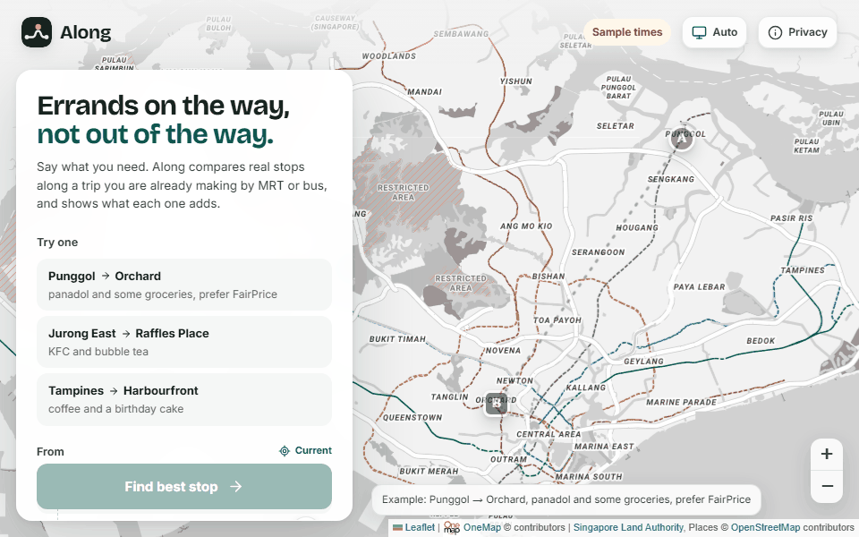
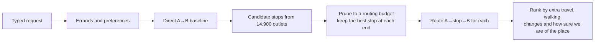
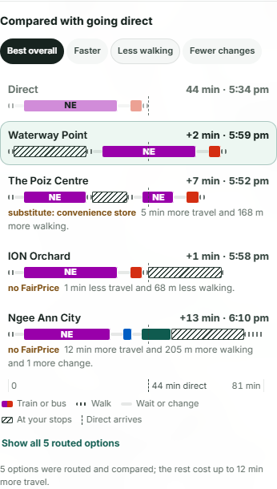
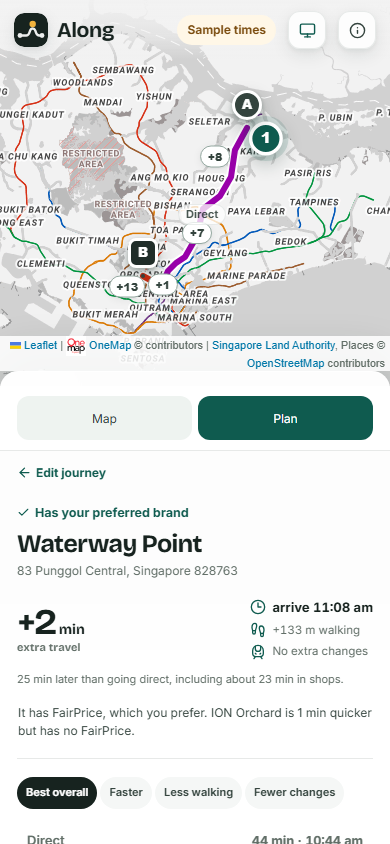
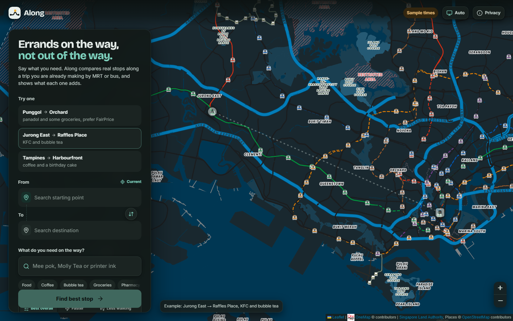

# Along

**Errands on the way, not out of the way. Journey-aware errand planning for Singapore public transport.**

**Try it:** [along-sg.onrender.com](https://along-sg.onrender.com). It runs on a free host
that sleeps when idle, so the first visit can take about a minute to wake it. Meanwhile the
three examples show a saved run, labelled as such.



You're going from Punggol to Orchard and need panadol and groceries. A maps search shows you
the nearest pharmacy. Along answers a different question: **which real stop gets both errands
done with the least extra travel, measured against the trip you were already making?**

Here it picks Waterway Point, a two-minute walk from where you start. That costs **+2 min of
extra travel** on the North East Line you were going to ride anyway, plus about 23 minutes in
the shops. It also says why: *"It has FairPrice, which you prefer. ION Orchard is 1 min quicker
but has no FairPrice."*

## Why this doesn't exist already

- **Google Maps and Apple Maps can add stops to a car route, but not to a public-transport
  one.** Google's help page says multi-stop directions are "not available for public transit".
- **Moovit lets you add a stop, but you pick it.**

No mainstream planner takes errands as categories ("panadol" means any pharmacy), prices each
candidate stop as a full MRT and bus journey, and chooses the one that adds least to the trip.
Formally it's a small *traveling purchaser problem*: visit one place from each errand's set at
least added cost. It becomes an *orienteering problem with time windows* once opening hours
matter.

## How it decides



1. **Read the request.**
   - "need to grab panadol and some groceries, prefer FairPrice" becomes two errands, a
     brand preference and the walking default.
   - "coffee, not Starbucks" excludes a brand, and "kopi" or "奶茶" map to their errands.
   - "before 7pm" becomes an arrival limit.
   - A deterministic parser does this. Anything it can't read is reported back, never
     silently dropped.
2. **Price the direct trip first.** Every option is measured against it.
3. **Find candidates, then prune before routing.** A live router is slow and rationed, so
   candidates are ranked by a network-distance proxy. The best stop beside each end is always
   kept.
4. **Route each survivor** as A, then the stop, then B. A two-stop plan is routed in both
   orders.
5. **Rank and explain.**
   - Places listed as closed when you'd arrive are dropped.
   - The pick's explanation is written from the comparison. It names the quicker rival and
     the reason the pick still wins.

What every figure and label means: [`docs/ranking.md`](docs/ranking.md). The story and the
trade-offs: [`docs/case-study.md`](docs/case-study.md).

## Seeing the detour



The comparison is the product, so it's drawn rather than described:

- **One bar per option, on one time axis.** Each ride is in its line's colour and carries its
  line code, with walks and waits between, and the time in shops is an outlined block with a
  bag in it. The bars label themselves, so the diagram has no key.
- **The direct trip is the top bar.** A dashed line marks where it arrives on every row, so how
  far an option runs past that line is how much later you arrive.
- **The number on each row is extra travel.** It's what differs between places, and the same
  figure the headline and the map pins use.
- **Tags say what an option is.** "no FairPrice", "substitute: convenience store" and "skips
  pharmacy" mark an option as a different kind of answer, not just a cheaper one.

Below it, the plan is a timeline whose clock times all come from the router and add up. Each
plan is a shareable link. Google Maps receives it one leg at a time, because it can't take a
stop on a transit route.

<br clear="right">

<p>
  
  
</p>

## Measured, not claimed

| What | Result |
| --- | --- |
| Request parsing: 112 everyday phrasings | 98% correct |
| …of which 52 held out, written before tuning (negation, typos, Singlish, Chinese, times) | 96% (was 40%) |
| Pruning vs. an unpruned search, 20 journeys | same pick on 18; misses within 1.6 min |
| Golden journeys on the real catalogue | explanations, limits and fallbacks checked on 8 trips at 10:00, and one at 8:00 |
| Backend tests | 516 passed |
| Browser tests, API stubbed: phone and desktop × light and dark, and iPhone WebKit | 234 passed |
| Words on screen outside controls, input screen / a result | 9 / 130, down from 68 / 187 |
| Browser tests against the real API and production build | 14 passed |

- **Phrasings:** [`backend/data/phrasing-evaluation.json`](backend/data/phrasing-evaluation.json),
  scored by `backend/tools/evaluate_phrasings.py`. CI fails below 90%. The two held-out misses
  are left in on purpose: "good morning" is accepted as an errand, and "withdraw money lah"
  isn't understood.
- **Pruning:** `backend/tools/compare_exhaustive.py`.
- **Scope:** none of this is a claim about real-world recommendation quality. That depends on
  live routing and on how complete the place data is.

## Run it

Everything runs offline by default: no keys, no accounts.

```powershell
# backend: FastAPI on :8000
cd backend
python -m venv .venv
.\.venv\Scripts\python.exe -m pip install -r requirements-dev.txt
.\.venv\Scripts\python.exe scripts\ingest_osm_pois.py --input data\singapore-osm-pois.json
.\.venv\Scripts\python.exe -m uvicorn app.main:app --port 8000

# frontend: Next.js on :3000
cd frontend
npm ci
npm run dev
```

**The catalogue.** Building it takes about 15 seconds. It holds 14,924 outlets from
OpenStreetMap, SingPost post offices and the HSA pharmacy register. Without it the app boots on
a 30-outlet seed, enough for tests but not for judging a recommendation.

**Production and hosting.** `Dockerfile` builds one container that bakes in the catalogue and
serves the static frontend from FastAPI. [`docs/deploy.md`](docs/deploy.md) puts it on Render's
free plan.

**Offline routing uses the real rail network.** With `ONEMAP_MOCK=true` (the default), routes
are computed over Singapore's actual rail network, built from LTA's station codes:

- real lines, real interchanges and real stop counts;
- the Changi Airport shuttle and the LRT loops.

Only the minutes are estimates, and the app bar says "Sample times". For live routing, set
OneMap credentials and `ONEMAP_MOCK=false`. [`.env.example`](.env.example) documents every
setting.

### Checks

```powershell
cd backend;  .\.venv\Scripts\python.exe -m pytest -q
cd backend;  .\.venv\Scripts\python.exe tools\evaluate_phrasings.py --min-pass 0.9
cd backend;  .\.venv\Scripts\python.exe tools\compare_exhaustive.py
cd frontend; npx tsc --noEmit; npm run lint; npm run test:e2e; npm run test:e2e:real
```

## Stack

| Area | Technology |
| --- | --- |
| Frontend | Next.js 16 (static export), React 19, TypeScript, Leaflet; Inter and Bricolage Grotesque |
| Backend | FastAPI, Pydantic, HTTPX |
| Data | SQLite + FTS5; OpenStreetMap (ODbL); HSA pharmacies via data.gov.sg; LTA rail gazetteer |
| Routing / geocoding | OneMap, behind a provider interface with an offline rail-network router |
| Optional | LTA DataMall bus arrivals; TomTom, Geoapify, Tavily discovery; OpenAI intent fallback |
| Testing | Pytest, Playwright, golden journeys, phrasing evaluation, pruning comparison |

```text
backend/app/
  main.py          app wiring only
  api/             HTTP routes by area: places, journeys, intent, admin
  services/        parser, discovery, candidates, optimiser, explanations
  providers/       OneMap, the offline rail network, DataMall, place search
frontend/app/
  page.tsx         the planner
  share.ts         a plan as a link
  components/      map, location fields, result panel
  components/planner/  notices, trip options, request types
  components/journey/  detour diagram, timeline, and the figures they share
```

## Privacy

- **What's collected:** nothing about you. There's no account, no analytics and no tracking
  identifier.
- **What a journey is used for:** the one request that plans it. It isn't stored.
- **Keys:** provider credentials stay on the server.
- **Limits:** per-client rate limits are kept in memory only.

Details: [`docs/privacy.md`](docs/privacy.md).

## Limitations

- Singapore only, public transport only, one or two errands.
- **Opening hours are partial.** Hours are published for about 20% of outlets; the rest show
  as unknown rather than guessed. Stock is never claimed.
- **The public demo's times are estimates.** Buses appear only as unnamed feeder legs.
- **Offline postal codes are approximate.** They resolve from the roughly 2,100 the
  catalogue's addresses contain, and otherwise to the middle of their postal sector, labelled
  approximate. OneMap resolves every one.
- **No turn-by-turn navigation.** A plan hands off to a maps app.

Release history: [`CHANGELOG.md`](CHANGELOG.md). Code: MIT ([`LICENSE`](LICENSE)). Place data
© OpenStreetMap contributors (ODbL), with sources in
[`docs/data-sources.md`](docs/data-sources.md). Basemap © OneMap / Singapore Land Authority.
